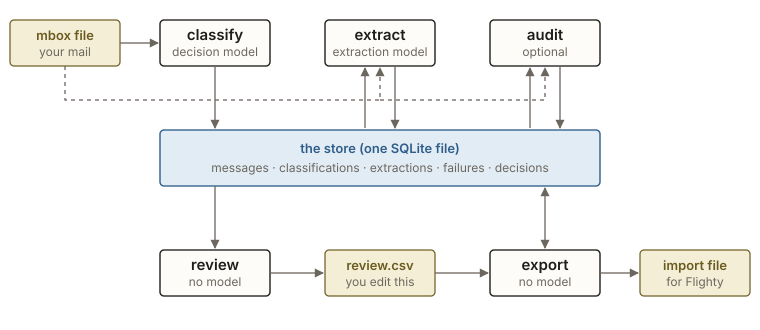

# flighty-exporter

flighty-exporter reads a Google Takeout export of your Gmail (an mbox file),
finds the emails about flights you booked, lets you check them, and writes a
file you can import into Flighty, so the app knows about flights from before
you started using it. The emails are read by two language models running on
your own machine through Ollama.

**Status.** This is a personal project, shared as is, with no support
promised. Its author has run it on macOS with Apple silicon and on Windows
with an NVIDIA graphics card; the test suite passes on both. The screens have been exercised by scripted
walkthroughs, but some paths have not been checked by hand against a real
model server: downloading a model from inside the application, the key that
shows the import file in the file manager, and the screens shown when the
server is down. Two limits to know before you start: classification takes
roughly 0.6 to 1.3 seconds per message on an Apple M5 Pro, so a large mailbox
takes many hours there (about 0.1 seconds per message was measured on an RTX
4090; see [Performance](#performance)); and the extraction model
reports a confidence of 1.0 for everything, so do not rely on that figure.

What it is not:

- It is not affiliated with or endorsed by Flighty.
- It never contacts Flighty. It writes a file; you send that file to Flighty
  yourself.
- Email content goes only to a model server on your own machine. The only
  other network access is a one-time download of two public reference files
  (see [Privacy](#privacy)). It never touches your live Gmail account.

## Contents

- [Quick start](#quick-start)
- [The application](#the-application)
- [Importing into Flighty](#importing-into-flighty)
- [How it works](#how-it-works)
- [Privacy](#privacy)
- [Performance](#performance)
- [Command reference](#command-reference)
- [Configuration reference](#configuration-reference)
- [Known limits and troubleshooting](#known-limits-and-troubleshooting)
- [Development](#development)
- [Licence and credits](#licence-and-credits)

## Quick start

**Requirements**

- macOS, Linux or Windows, and [uv](https://docs.astral.sh/uv/) (it
  installs Python 3.12 or later and the dependencies for you). On Windows,
  use Windows Terminal (with PowerShell or Command Prompt).
- [Ollama](https://ollama.com/download) 0.35.0 or later, running locally.
- The two models: `nimble` (the decision model, about 9.3 GB) and
  `gemma4:12b-it-q4_K_M` (the extraction model, about 8 GB). The application
  offers to download them; or run `ollama pull` for each yourself.
- Memory: tested on a machine with 24 GB of RAM.
- Flighty Pro, if you want to import flights older than a year (Flighty's
  rule, not this tool's).

**Getting your mail.** Use Google Takeout (takeout.google.com) while signed
in to the Google account whose mail you want. Deselect everything, select
only Mail (Takeout exports Gmail in the mbox format), create the export and
download it when Google says it is ready, which can take hours or days for a
large mailbox. Unpack the archive: the mailbox is a single `.mbox` file
under `Takeout/Mail/`, in an English-language account usually called
`All mail Including Spam and Trash.mbox`. You can leave all mail included;
the tool skips messages under the Spam, Trash, Drafts and Chat labels
itself. Google's menus change from time to time; look for the Mail product
in Takeout's list and its format options.

**Running it.**

```
git clone https://github.com/Igman/flighty_exporter.git
cd flighty_exporter
uv run flighty-exporter
```

`uv run` installs everything on first use. The command opens a full-screen
application in your terminal. It asks three questions (your mailbox file,
your name as it appears on bookings, and Quick or Thorough), writes them to
`flighty_exporter.toml` in the current folder, checks that Ollama is ready
(offering to download a missing model), and runs. Classifying a large
mailbox takes hours (see [Performance](#performance)); you can quit at any
time and the next launch carries on. When the run is complete you review the
flights it found and export the import file for Flighty. Every file the tool
writes goes next to the config file.

## The application

The bare command (`uv run flighty-exporter`, or
`uv run flighty-exporter --config FILE`) opens the application when both
input and output are a terminal. Outside a terminal (piped, or from a script) it
prints the help (as `--help` does) and a line saying the application opens
only in a terminal and a command is needed otherwise, and exits with status
2; use [`run`](#run) there.
Ctrl-Q quits from any screen.

The screens, in the order you meet them:

### Setup (first launch)

With no session yet (no store file), the application starts with setup,
filled in from the config file if there is one:

1. **Your mailbox file**: the path to the `.mbox` file. Dragging the file
   into the terminal pastes its path; a relative path is read from the
   current folder. It is checked when you leave the field: a missing file, a
   folder, an unzipped Takeout folder, a `.zip`, an empty file or a file that
   does not begin like an mbox is refused with a message saying what to
   point at instead.
2. **Your name variants**: your name as it appears on bookings, one per line
   or separated by commas (with and without a middle name, a maiden name,
   and so on). They are used to leave out bookings you made for other
   people. Case, accents, word order, punctuation and titles are ignored, so
   `ELLIS/JORDAN MR` already matches `Jordan Ellis` (see
   [passenger filtering](#passenger-filtering)). Leaving it empty turns
   passenger filtering off: every booking is kept. A line that names no one
   (such as `Mr`) is refused.
3. **How thorough to be**: Quick (the default) classifies every email and
   extracts the flight emails. Thorough also checks, after extraction, for
   flight emails the first filter missed, which takes roughly 2 to 35
   minutes more, and may lower the threshold for this session (see
   [Thoroughness](#thoroughness)).

A "You entered" panel repeats your answers. Ctrl-S (or the button) writes
them to the config file, creating it if needed; every other setting, comment
and section in an existing file is left as it is. A mailbox inside the
config file's folder is written as a relative path.

**The model-server step** follows. It shows whether the Ollama address is
on this machine, whether the server answers, its version, and each model as
ready or missing with its approximate size. Keys:

- `c` checks again (after starting Ollama, for example);
- `d` downloads the next missing model, after a confirmation (`y`/`n`)
  that names it and its size, with a progress bar; quitting during a
  download is fine, because Ollama keeps the partial download;
- `s` starts the run once everything is ready;
- `b` goes back to the answers; `q` quits.

A non-local Ollama address is refused here as everywhere (see
[Privacy](#privacy)); the application has no `--allow-remote`, so the only
fixes are pointing `[ollama] address` at this machine or setting
`allow_remote = true` in the config file, then starting again.

### Resume or start fresh (later launches)

When a session exists, the application describes it: the store and the
mailbox (marked "no longer there" if the file has moved), when it started
and was last active, the names and thoroughness it was started with, how
many emails were read (messages under Spam, Trash, Drafts and Chat are not
counted), how many likely flight emails were extracted, the flights and
saved decisions, the threshold in use, and how many files the session wrote.
Then:

- `r` resumes. An unfinished run carries on where it stopped, sending
  nothing finished to a model again. A finished run opens its review
  directly; that needs only the store, not the mailbox.
- `f` starts fresh, after one confirmation (`y` to confirm, `n` or Escape
  to go back) listing what would be lost (for example "classification of
  200 emails", "extraction of 16 emails, and 77 more read by the check for
  missed flight emails", "2 generated files").
- `q` quits.

**Starting fresh deletes** the files the tool recorded writing for the
session that still exist (the review table, the failures file, the audit
report, every import file and the manual-add list), then the store with its
`-wal`, `-shm` and `-journal` side files. With the store go every result,
the saved email text, your review decisions and manual-add ticks, and the
session's lowered threshold. **It keeps** the mailbox, the config file,
downloaded models, the cached OpenFlights data and any file the tool did not
record writing (your own files in the same folder are safe). Setup then opens
with the previous answers filled in (the mailbox as the config file has it,
so a relative path stays relative).

**Changing any setting means starting fresh.** There is no settings screen:
a session's settings are fixed once it starts. To change your names, the
mailbox or the thoroughness, start fresh and answer setup again. Be careful
with the names: starting fresh repeats classification, which is many hours
on a large mailbox.

### The run

The progress screen runs the stages in order: classify, extract and review
for Quick; classify, extract, audit, include and review for Thorough (what
each does is under [How it works](#how-it-works)). It shows every stage
with its state (waiting, running, done, nothing to do, stopped or skipped,
with the reason for a skip), a progress bar for the running stage with
messages done out of the total, the seconds per message and the time
remaining, running counts (classified, resolved from machine-readable data,
skipped, failed; extracted N of M; the audit's sample), and a Notices panel
for warnings.

Keys:

- `p` pauses after the message in progress, and `p` again continues;
- `q` quits after the message in progress (`q` or Ctrl-C again quits at
  once); the next launch carries on, and at most the message in progress is
  redone;
- `r` retries after a problem, once you have fixed it.

A problem with the model server (not running, too old, a model missing, or
the server going away mid-stage) stops the run with a red Problem panel
holding the same message the commands print (see
[Troubleshooting](#troubleshooting)). A message that fails is counted, and
the run goes on; failed messages are tried again on the next run.

When the run finishes, a Report panel shows the end-of-run report: flights
found (confirmed and booked only), flights needing attention and the count
per reason, flights pre-set to not keep, bookings cancelled, bookings with
replaced segments, bookings dropped as other passengers', saved decisions
discarded because their flight is no longer produced, messages that failed
per stage, PDF attachments not read, what the check for missed flight
emails found and changed, and the files written. Press `enter` to review
the flights.

### The review

The review opens only after a complete run, so you never judge a booking
before its cancellation or schedule change has been read. Every decision is
saved in the store the moment you make it, so quitting loses nothing and
the review can span several sittings; the `review`, `export`, `flights` and
`decide` commands see the same decisions.

At the top: the totals (`Flights: N · kept K · not kept M · needing
attention A`, over every flight whatever the filters show) and the active
filters. Then the table, one row per flight, with the columns:

| Column | Meaning |
| --- | --- |
| `date` | Local departure date, `YYYY-MM-DD`. |
| `flight` | Flight number with the airline prefix, `(none)` when there is none. |
| `route` | Origin and destination airport codes, `LIS-OSL`. |
| `airline` | As the email names it. |
| `booking` | Booking reference (several joined with `; `). |
| `evidence` | `confirmed` or `booked only` (see below). |
| `keep` | `yes` or `no`: only kept flights are exported. |
| `corrected` | `corrected` when you have corrected the flight. |
| `reasons` | Its attention reasons, blocking ones in red, advisory in yellow. |

Flights with a blocking reason come first, then flights with only advisory
reasons, then the rest, each group by date and flight number.

**Attention reasons.** Blocking reasons pre-set `keep` to `no`; keep the
flight yourself if you have checked it (correcting it if needed):

- `unknown airport XXX`: the code is not in OpenFlights' airport data.
- `unknown airline XX`: no airline in OpenFlights' data has this prefix.
- `malformed flight number`: not a two-character airline designator (with
  at least one letter) followed by 1 to 4 digits and an optional letter.
- `origin and destination are the same`
- `implausible date`: before 1990, or more than 400 days after the latest
  email about the flight.
- `low confidence`: the model's confidence, halved once for each reason
  above, is below `[review] min_confidence` (0.7).

Advisory reasons leave `keep` at `yes` but ask you to look:

- `no flight number`: the export puts the flight on the manual-add list.
- `email was truncated before extraction`: the email was longer than the
  extraction input limit, so part of it was not read.
- `no passenger named`: the booking names no passenger, so the tool cannot
  tell whether it is yours.

The airport and airline checks need OpenFlights' reference data, downloaded
on first use; if it cannot be loaded, those two checks are skipped and the
others still run.

**Evidence.** A flight is `confirmed` when a check-in, boarding-pass or
post-flight email exists for it, and `booked only` otherwise. It is for your
judgement and never removes a flight.

**The detail panel** below the table follows the cursor: every field,
passengers and confidence, `keep` with whether it is the pre-set value or
your choice, each reason marked blocking or advisory, each correction next
to the value the tool found, for a kept flight that goes on the manual-add
list whether you have ticked it as added by hand in Flighty (and why it is
on the list), and its source emails with dates and subjects.

**Keys:**

| Key | Action |
| --- | --- |
| Arrow keys | Move between flights. |
| Space or `k` | Keep or drop the selected flight. |
| `enter` | Read its source emails: each one's date and subject, then the saved text (sender, subject, date, the cleaned body and any PDF text). Escape returns. The mailbox file is not needed. |
| `c` | Correct its date, flight number, origin or destination. `enter` saves, Escape cancels. The corrected flight is checked like any other: a correction to an unknown airport is flagged, a fixed code clears its reason. An unreal date or an empty airport is refused and nothing is saved. Codes are upper-cased; flight numbers lose spaces, hyphens and dashes. A value typed back to the original removes that correction. |
| `u` | Clear your decision on it (asks first if it holds a correction). The manual-add tick stays. |
| `f` | Show only flagged flights (any attention reason); again to show all. |
| `n` | Show only flights not kept; again to show all. |
| `y` | Step through the years present, oldest first, then back to all years. |
| `d` | List the bookings dropped as other passengers' (reference, passengers, flights, first date). |
| `x` | List the emails that passed the first filter but could not be read (date, sender, subject, reason): look these up yourself. |
| `e` | Go to the export. |
| `q` | Quit. |

The filters combine. A flight sent by an older version of the tool may show
`source text unavailable (extracted before text was saved)` in place of its
text. Flights the tool missed entirely are added directly in Flighty; the
application has no "add flight" action.

### The export

Press `e` in the review. The export screen first shows the plan, writing
nothing: how many flights go in the import file, how many must be added by
hand, and how many are not kept (the same numbers as
`export --from-store --dry-run`). Keys:

- `e` (or `enter`) writes the files: the import file
  `openflights-backup-YYYY-MM-DD-HHMM.csv` (the time is UTC; an export in
  the same minute as the previous one replaces it) and `manual-add.csv`,
  next to the config file. The screen shows the import file's full path and
  the steps for [importing it into Flighty](#importing-into-flighty).
- `o` shows the import file in Finder (macOS) or File Explorer (Windows);
  elsewhere the screen names the folder.
- Space ticks the selected flight on the "Add by hand in Flighty" checklist
  (date, route, flight number, reason) once you have entered it in Flighty.
  Ticks are saved at once and written to `manual-add.csv` without exporting
  again, so you can work through the list over several sittings.
- `r` retries after a problem (the reference data could not be loaded).
- `b` goes back to the review with its filters and selected flight as you
  left them, so you can change a decision and export again.
- `q` quits.

A kept flight goes on the manual-add list instead of the import file when it
has `no flight number`, is `dated before 2006` (Flighty has no records
before then), or has an `airport XXX not in OpenFlights data` or `no
OpenFlights airline for prefix XX`. Nothing is sent anywhere: the screen only
writes local files.

## Importing into Flighty

What was verified (November 2026, with a file written by this tool's
export):

- Flighty's OpenFlights import works by emailing the file to an address the
  app gives you. The test reached it through Settings, then Import Flights,
  then OpenFlights.
- Flighty accepted the generated file and imported its flights, including
  one older than a year. Airline, route and the direction of each flight
  were as submitted.
- A flight Flighty already had was not imported a second time.

Not recorded: which further details (aircraft, times, terminals) Flighty
filled in itself.

Be aware: Flighty documents support only for files exported by OpenFlights
itself. This tool writes OpenFlights' backup format without going through
OpenFlights. It was accepted when tested, but may stop working if Flighty
tightens its checks.

Flights on the manual-add list are entered by hand in Flighty, which needs
only the two airports and the date.

## How it works



The stages never call each other; everything passes through the store, one
SQLite file. The single commands, `run` and the application all use the
same stages. The review table (`review.csv`) is one way to hand your
decisions to the export, not the only one: decisions live in the store, the
application writes them there directly, and `export` records the edits of a
review table there before exporting. Dashed arrows: extract and audit go
back to the mailbox for message bodies, reading only the messages they need
(classify records where each message sits in the file).

**Classify.** Every message except those under Spam, Trash, Drafts and Chat:

- Machine-readable data first. A message that carries schema.org
  FlightReservation markup (which many airlines embed for Gmail) or a flight
  calendar (`.ics`) attachment is read directly, with no model, and its
  flights go to the review with confidence 1.0. Incomplete markup, and
  calendar events with only UTC times, are ignored and the message is
  classified like any other.
- Every other message goes to the decision model (`nimble`) with its
  sender, subject, attachment file names and the start of its body (PDF text
  is not sent at this stage). The model gives a probability for the gate
  question "does this email contain flight details for a specific booking?"
  and an email type (`booking confirmation`, `change`, `cancellation`,
  `check-in or boarding pass`, `post-flight`, `marketing` or `other`).

**The threshold.** Messages whose gate probability is at or above
`[classify] threshold` (default 0.05, deliberately low because the
probabilities are not calibrated) go to extraction. It is applied when
extract selects messages, never at classify time, so changing it never
means classifying again. A Thorough run may lower it for its session: that
is the **effective threshold**, stored in the store (the config file is
never rewritten) and used by every later extract, audit, review, export and
sources on that store. The lower of the configured and the effective
threshold applies.

**Extract.** Each selected message without an extraction goes to the
extraction model (`gemma4:12b-it-q4_K_M`), which reads the whole cleaned
body plus the text layer of any PDF attachment (up to
`[extract] max_input_chars` characters) and returns the email kind
(`booking`, `change`, `cancellation`, `check-in` or `other`), the booking
reference, the passenger names and each flight segment: local departure
date, airline, flight number, origin and destination, confidence. An
invalid or cut-off answer is retried (`[extract] retries`) and then
recorded as a failure, to be tried again on the next run. The text of each
email that yields a flight record is saved in the store for the review.

### Thoroughness

**Quick** runs no audit. **Thorough** runs the audit after extract: the
classified messages are divided into gate bands (`[0, 0.001)`,
`[0.001, 0.005)`, `[0.005, 0.01)`, `[0.01, 0.02)`, `[0.02, 0.05)`,
`[0.05, 0.1)`, `[0.1, 0.2)`, `[0.2, 0.5)`, `[0.5, 1]`); up to
`[audit] sample_size` messages from each band, and separately from each
band's messages with a PDF attachment, are sent to the extraction model; the
report gives each band's hit rate. Then the include stage: if a sampled
message below the threshold contained flights, the lower edge of the lowest
such band is the suggested threshold, and the messages it would add that
have no extraction yet are counted. If that count is at most
`[audit] auto_include_budget` (default 2,000), the session's threshold is
lowered and those messages are extracted (the ones the audit already read
are not sent again). Over the budget nothing changes, and the report says
what was found, how many emails including it would add, and how to include
them (set `[classify] threshold` to the suggested value, or raise the
budget, then run again). This happens once per run; the end-of-run report's
"check for missed flight emails" lines say what happened, for example:

```
threshold lowered from 0.05 to 0.02 for this session; 3 emails newly included by the lower threshold (1 already read by the check, 2 read now), 3 of them with flights
```

### Consolidation

Review turns the extraction records of every message at or above the
threshold, and of every message resolved from machine-readable data, into
one row per flight:

- **Bookings.** Emails sharing a booking reference are one booking. An email
  with no booking reference joins a booking that already has the same
  flight (date and flight number); otherwise it forms its own booking.
- **Cancellations.** A cancellation email removes every flight the booking
  has so far. A later booking or change email under the same reference
  brings flights back (a rebooking).
- **Changes, per leg.** A flight in a later booking or change email replaces
  earlier flights of the booking with the same origin and destination. Legs
  the later email does not mention are kept.
- <a id="passenger-filtering"></a>**Passengers.** A booking whose passengers
  include none of your name variants is dropped with all its flights, and
  listed (`d` in the review). Matching ignores case, accents, word order,
  punctuation and titles (Mr, Mrs, Dr, Herr, Mme, ...). A passenger matches
  when every word of one of your variants is in the passenger's name (extra
  middle names on the ticket are fine), or when the passenger's name has at
  least two words and all of them are in your variant (a ticket that leaves
  out your middle name). There is no fuzzy or initial matching. A booking
  that names no passenger is kept and flagged `no passenger named`. With no
  names configured, filtering is off.
- **Duplicates.** The same flight from several bookings or emails (same date
  and flight number, or same date and route when there is no flight number)
  appears once.
- **Evidence.** `confirmed` when a check-in, boarding-pass or post-flight
  email exists for the flight, `booked only` otherwise.

Then **validation** adds the [attention reasons](#the-review) and pre-sets
`keep`.

### Decisions, corrections and the session

A **decision** belongs to a flight, identified by its date and flight
number as the tool found them (or date and route when there is no number);
this is the `flight_id` column of the review table. It holds an optional
keep choice, optional corrections to date, flight number, origin and
destination, and the manual-add tick. Corrected flights are validated again,
so their reasons and pre-set keep follow the corrected values; then your
keep choice wins over the pre-set one.

**Decisions follow the latest result.** If a later run no longer produces a
flight (say a cancellation email was found), its decision is discarded, and
the end-of-run report counts these.

A **session** is one store plus the files the tool generated from it. The
store records the mailbox and settings the session was started with (by the
first command that brought a mailbox to it), when it was last active, the
effective threshold, and every file the tool wrote for it. `session`
describes it and `run --fresh` (or `f` in the application) starts fresh.

## Privacy

**Email content goes only to a model server on this machine.** Everything
that uses a model (`run`, `classify`, `extract`, `audit`, the application)
sends email text to `[ollama] address`, and refuses to start if that
address is not on this machine. Local means `localhost`, an address in
127.0.0.0/8, `::1`, or a host name that resolves only to those; a name that
does not resolve counts as not local. `setup --check` and `pull-models`
apply the same rule.

**The override.** If you really mean to use an Ollama server on another
machine, set `allow_remote = true` under `[ollama]` (or pass
`--allow-remote` to a command). Every run then warns:

```
warning: email content is being sent to the Ollama server at http://..., which is not on this machine (allow_remote or --allow-remote is set).
```

**Proxies are bypassed.** Requests to Ollama ignore `HTTP_PROXY` and similar
settings, because a proxy would carry email content off the machine even
when the address is local.

**The only other network access** is the download of OpenFlights'
`airports.dat` and `airlines.dat` from `[export] data_url` the first time
review or export needs them. They are cached in `[export] data_dir`
(default `~/.cache/flighty_exporter/openflights`, on Windows
`C:\Users\<you>\.cache\flighty_exporter\openflights`) and reused; the download
sends nothing about you. Model downloads (`pull-models`, `d` in setup) are
made by your Ollama server, only after you confirm.

**What is stored, and where.** All of it next to the config file unless you
choose other paths. These files hold personal data (your senders, subjects,
dates, email text, names and flights); keep them private and never commit
them:

| File | Default name | Written by |
| --- | --- | --- |
| Your config (paths, name variants) | `flighty_exporter.toml` | you, setup |
| The store: every result, the text of the emails flights came from, decisions and session values (SQLite) | `flighty_exporter.db` (and `-wal`, `-shm` side files) | every command that writes results, the application |
| The review table | `review.csv` | `review`, `run`, the application's run |
| The failures file | `failures.csv` | `review`, `run`, the application's run |
| The audit table | `audit.csv` | `audit`, Thorough runs |
| The import file | `openflights-backup-YYYY-MM-DD-HHMM.csv` | `export`, the application's export |
| The manual-add list | `manual-add.csv` | `export`, `mark-added`, the application's export |

The repository's `.gitignore` covers these default names, mbox files and
Takeout archives. It cannot know names you choose yourself (with
`--output`, `--store`, `--review`, `--output-dir`, `--config` or the config
file): keeping those out of version control is up to you.

## Performance

Measured on an Apple M5 Pro with 24 GB of RAM:

- **Classification:** about 0.6 to 1.3 seconds per message. This is the long
  part: roughly 8 to 18 hours per 50,000 messages.
- **Extraction:** about 3 seconds per selected message, for the small
  fraction of the mailbox that passes the gate.
- **The check for missed flight emails** (Thorough): about 2 seconds per
  sampled message; at the default sample size, at most 450 extractions
  (25 for each of 9 bands, for all messages and again for messages with a
  PDF), minus those already extracted.
- **Review and export:** seconds.

A Thorough run of the 200-message synthetic mailbox (see
[Development](#development)) took 5 minutes 20 seconds. Time per message
depends on message length. For a large mailbox, plan on classification
spanning several sittings: every result is saved as it is known, so quitting
(or a closed laptop) loses at most the message in progress. The progress
screen's time remaining is computed from the current run's rate.

## Command reference

Every command takes `--config FILE` before the command name
(`uv run flighty-exporter --config ~/flights/flighty_exporter.toml run`);
without it, `./flighty_exporter.toml` is used if present, else the built-in
defaults. Exit status: 0 on success, 1 on an error, 2 on a usage error, 130
after Ctrl-C. Every model command can be stopped with Ctrl-C and resumed by
running it again. Before its first model request it checks that Ollama is
local, running, version 0.35.0 or later and has the model it needs, and
stops with an instruction if not. Progress (time per message and time
remaining) goes to stderr.

### run

```
uv run flighty-exporter run [--mailbox MAILBOX] [--store STORE] [--allow-remote]
    [--thoroughness {quick,thorough}] [--output OUTPUT] [--failures FAILURES] [--force] [--fresh]
```

The application's run without the screen, for scripts and SSH: classify,
extract (Thorough: audit and include), then review, printing each stage's
start, progress and summary (each stage's summary ends with `Session
totals so far:`, the figures the application's Counts panel shows), then the
end-of-run report, ending with the
files written and `Next step: check <path>/review.csv, then run export.` It
resumes an
existing session by default and never asks a question. `--thoroughness`
overrides `[run] thoroughness`. `--output` and `--failures` set the review
table and failures file; an edited review table is left as it is (the report
says so) unless `--force`. `--fresh` starts fresh without asking (deleting
what [starting fresh](#resume-or-start-fresh-later-launches) deletes,
printing a line for each) and then runs from scratch. A model-server problem
stops it with the commands' message and status 1; Ctrl-C stops it with 130
and `kill` (SIGTERM) after the message in progress with 143. Windows has no
SIGTERM: there Ctrl-Break (or a CTRL_BREAK_EVENT sent to its process group)
stops it after the message in progress, with 143.

### classify

```
uv run flighty-exporter classify [--mailbox MAILBOX] [--store STORE] [--allow-remote]
```

Reads every message, resolving machine-readable flight data directly and
sending every other message to the decision model; stores both answers.
Prints the messages in the mailbox, classified, already classified,
resolved from machine-readable data, skipped and failed, then for the stored
results how many are at or above the threshold, how many have a gate of at
least 0.5, 0.2 and 0.05, and the count per email type.

### extract

```
uv run flighty-exporter extract [--mailbox MAILBOX] [--store STORE] [--allow-remote]
```

Sends each message at or above the threshold that has no extraction yet to
the extraction model. If the mbox file has changed since classify (a new
export) or the store predates message positions, it first scans the
mailbox's headers once (`extract: locating messages`). Prints the messages
selected (`selected (gate >= 0.05)`), extracted, already extracted,
retried, failed, not found in the mailbox, inputs truncated and PDFs not
read, then the segments and email kinds stored.

### audit

```
uv run flighty-exporter audit [--mailbox MAILBOX] [--store STORE] [--sample-size SAMPLE_SIZE]
    [--seed SEED] [--output OUTPUT] [--allow-remote]
```

The check for missed flight emails on its own (see
[Thoroughness](#thoroughness)). Prints a table per band for all classified
messages and for messages with a PDF attachment (`messages`, `sampled`,
`failed`, `with segments`, `hit rate`, `est. flight emails`), the sampled
messages below the threshold that contained flights, and a reading such as
`Reading: the lowest band with a hit is [0.01, 0.02) (gate 0.0132); [classify] threshold = 0.01 would include it (now 0.05).`
It never changes the config: lower the threshold yourself and run extract
again, which sends only the newly included messages not already extracted.
The same seed gives the same sample. The report is also written to
`audit.csv` (`--output`).

### review

```
uv run flighty-exporter review [--store STORE] [--output OUTPUT] [--failures FAILURES] [--force]
```

No model; seconds. Builds the flight list (consolidation, validation, saved
decisions) and writes the review table and the failures file, then prints
the flights, confirmed and booked only, needing attention and pre-set to not
keep, the count per reason, bookings cancelled and with replaced segments,
the bookings dropped as other passengers', and the failures. It overwrites
the review table only if you have not edited it since it wrote it; use
`--force` to overwrite anyway or `--output` to write elsewhere.

The failures file lists (message ID, date, sender, subject, reason) every
message at or above the threshold with no valid extraction, and every PDF
attachment that could not be read (image-only, encrypted, too large or
unreadable).

### export

```
uv run flighty-exporter export [--review REVIEW] [--output-dir OUTPUT_DIR] [--store STORE] [--from-store] [--dry-run]
```

Writes the import file and the manual-add list (columns `date`, `origin`,
`destination`, `flight_number`, `reason`, `message_date`,
`message_subject`, `done`) into the config file's folder or `--output-dir`.
It reads the flights from:

- with `--from-store`, the store, even when a review table exists;
- with `--review PATH`, that table;
- otherwise, when there is a store: the configured `review.csv` if you have
  edited it since `review` (or `run`) wrote it, else the store. A table that
  does not exist, or is exactly as `review` wrote it, holds no edits, so a
  decision you made since in the application is exported, not undone;
- with no store, the review table, as it is.

Reading a review table with a store, export first records as decisions
only the values you changed in it (`keep`, `date`, `flight_number`,
`origin`, `destination`), matched by `flight_id` and compared with what
`review` wrote in that row; a value you left as written changes nothing, so
decisions made in the application for that flight, or for any flight whose
row you did not touch, stay. Each row with a `flight_id` is then exported as
the store has that flight, decisions applied; rows without one are exported
as the table has them. `--from-store --dry-run` prints the plan and writes
nothing. The summary gives where each file was
written, `flights exported`, `flights to add by hand`, the `source of the
export`, `decisions recorded from the review table` (when a store is used
and a review table was read or found unedited), the rows read, `not kept`,
and `rejected as invalid` with the row
number and reason of each (a keep value that is not yes or no, a date that
is not a real `YYYY-MM-DD` date, an empty origin or destination).

### sources

```
uv run flighty-exporter sources [--store STORE] [--flight DATE FLIGHT] [--no-text]
```

Prints each flight review would list (date, flight number, route) with its
source emails' dates and subjects and their saved text, from the store
alone. `--flight 2025-05-12 ZZ1234` picks one flight (a route such as
`LIS-OSL` for a flight without a number), under its corrected values if you
corrected it; `--no-text` leaves the text out.

### flights

```
uv run flighty-exporter flights [--store STORE] [--flagged] [--not-kept] [--year YYYY]
```

Prints the flight list as the review screen shows it: the totals, the years
present, the table in the same order, then the bookings dropped as other
passengers' and the emails that could not be read. The filters combine.
Reads only.

### decide

```
uv run flighty-exporter decide DATE [FLIGHT_NUMBER] [--route ORIGIN DEST]
    (--keep | --drop | --reset | --set FIELD=VALUE) [--store STORE]
```

Makes one decision as the review screen does, saves it at once and prints
the flight's detail. Pick the flight by the date and flight number it now
shows, or `--route` for one without a number. `--set` takes `date`,
`flight_number`, `origin` or `destination` (repeat for several), normalised
as in the review; a value equal to what the tool found clears that
correction, and an unreal date or empty airport is refused with status 1.
A keep choice equal to the pre-set value saves nothing. `--reset` clears the
keep choice and corrections.

```
uv run flighty-exporter decide 2025-06-01 QQ410 --drop
uv run flighty-exporter decide 2025-07-01 ZZ300 --set destination=OSL --set date=2025-07-02
uv run flighty-exporter decide 2025-07-02 ZZ300 --reset
```

### mark-added

```
uv run flighty-exporter mark-added DATE [FLIGHT_NUMBER] [--route ORIGIN DEST] [--undo] [--store STORE]
```

Ticks a flight on the manual-add list as entered in Flighty by hand (`--undo`
removes the tick), by its date and flight number as the list shows them, or
`--route` for a flight without a number. A manual-add list an export has
already written is updated at once (`Manual-add list updated: PATH`); the
import file is not touched.

### session

```
uv run flighty-exporter session [--store STORE] [--fresh-preview]
```

Describes the session from the store alone: the mailbox (and whether it
still exists), what it was started with, when it started and was last
active, the messages recorded (messages under Spam, Trash, Drafts and Chat
are not counted), classified, resolved from machine-readable data, at or
above the threshold in use, extracted, failed, flights and flights with a
saved decision, its state, whether the run finished, where it stands (the
sentence the application's startup prompt shows), the threshold in use
(for example `0.02 (lowered for this session from the configured 0.05)`),
the files written that still exist, and what starting fresh would lose.
The state is `finished` once the run reached its end, even when a likely
flight email could not be read: then it reads `finished; 1 likely flight
email could not be read (the review lists it, and the next run tries it
again)`, next to `run finished: yes (resuming opens the review)`. Otherwise
it is `unfinished:` with why (`nothing classified yet`, `N emails still to
extract`, or `stopped before review`): the run stopped before its end, and
resuming carries on. With no store it prints `No session yet.` `--fresh-preview` lists what
starting fresh would delete, deleting nothing, and the answers setup would
then be filled in with.

### setup and pull-models

```
uv run flighty-exporter setup --mailbox MAILBOX [--name NAME ...] [--thoroughness {quick,thorough}] [--check] [--allow-remote]
uv run flighty-exporter pull-models [--yes] [--allow-remote]
```

`setup` checks and writes the three answers exactly as the setup screen does
(nothing is written if one is refused); `--check` then reports whether the
model server is ready (status 1 if not). `pull-models` lists the configured
models the server lacks with their approximate sizes, and with `--yes`
downloads them through the server, printing progress.

### The spreadsheet route

Instead of the application's review you can run the commands and edit the
review table in a spreadsheet:

```
uv run flighty-exporter run          # or classify, extract, [audit,] review
# edit review.csv in Numbers, Excel or LibreOffice
uv run flighty-exporter export
```

For each row, leave `keep` as it is or change it (`yes`, `y`, `true`, `1`
and `x` keep; `no`, `n`, `false`, `0` and an empty cell do not; case is
ignored; anything else is reported and the row skipped), and correct `date`,
`flight_number`, `origin` or `destination` in place, normalised as in the
review. Dates must stay `YYYY-MM-DD`; spreadsheets like to reformat them, so
check the column before saving. Leave `flight_id` as it is: it is how your
edits find their flight. Only what you change is recorded (see
[export](#export)), so you can mix the spreadsheet and the application: a
flight you decided in the application keeps that decision unless you change
its row. Only `keep`, the four correctable fields,
`message_date`, `message_subject` and `flight_id` are read. Reordered or
extra columns, headers with other case or stray spaces, other quoting and
line endings, a comma, semicolon or tab separator and blank trailing rows
are all tolerated. Save as CSV in UTF-8 ("CSV UTF-8" in Excel).

The review table's columns: `keep`, `needs_attention`, `attention_reason`
(every reason, blocking first, joined with `; `), `date`, `flight_number`,
`airline`, `origin`, `destination`, `booking_reference`, `passengers`,
`confidence`, `evidence`, `email_kind` (of the most recent email about the
flight), `source` (`markup`, `model`, or both), `source_count`,
`message_id`, `message_date` and `message_subject` (the most recent source
email, to find it in Gmail), `source_messages` (every source email as
`YYYY-MM-DD subject`, joined with ` | `) and `flight_id`.

Export records your edits in the store, so the application and a following
`review` show them; the two routes never disagree.

## Configuration reference

The config file is TOML; [`flighty_exporter.example.toml`](flighty_exporter.example.toml)
lists every setting with its default and a comment. Every setting is
optional. Relative paths are resolved against the config file's folder (the
current folder when there is no file). An unknown setting is an error.

| Setting | Default | Meaning |
| --- | --- | --- |
| `mailbox` | none | The Takeout mbox. Needed by `run`, classify, extract and audit unless given with `--mailbox`; setup writes it. |
| `store` | `"flighty_exporter.db"` | The store. Overridden by `--store`. |
| `[ollama] address` | `"http://127.0.0.1:11434"` | The Ollama server; must be on this machine unless `allow_remote`. |
| `[ollama] timeout_seconds` | `300` | Per-request timeout for model requests (the server checks use at most 5 seconds). |
| `[ollama] allow_remote` | `false` | Allow a non-local address (as `--allow-remote`); warns on every run. |
| `[models] decision` | `"nimble"` | Decision model. Results are stored per model: changing it means classifying again. |
| `[models] extraction` | `"gemma4:12b-it-q4_K_M"` | Extraction model, also per model. |
| `[classify] threshold` | `0.05` | Gate probability (0 to 1) at or above which a message is extracted. |
| `[classify] max_body_chars` | `12000` | How much of the cleaned body the decision model sees; a message still rejected as too long is retried with the body halved, up to 3 times. |
| `[extract] num_ctx` | `16384` | Context length per extraction request. |
| `[extract] num_predict` | `1500` | Output cap; an answer that stops at the cap is invalid. |
| `[extract] retries` | `2` | Retries of an invalid or cut-off answer. |
| `[extract] max_input_chars` | `36000` | Cap on what the extraction model reads (body, then PDF text). |
| `[review] output` | `"review.csv"` | Review table. Overridden by `review --output`, `run --output`, `export --review`. |
| `[review] failures` | `"failures.csv"` | Failures file. Overridden by `--failures`. |
| `[review] min_confidence` | `0.7` | Confidence (0 to 1) below which a flight is flagged `low confidence`. |
| `[passenger] names` | `[]` | Your name variants; empty turns passenger filtering off. |
| `[audit] sample_size` | `25` | Messages sampled per band. Overridden by `--sample-size`. |
| `[audit] seed` | `1` | Seed for the reproducible sample. Overridden by `--seed`. |
| `[audit] output` | `"audit.csv"` | Audit table. Overridden by `audit --output`. |
| `[audit] auto_include_budget` | `2000` | Thorough only: the most not-yet-extracted emails a lowered threshold may add for the run to lower it by itself; `0` lowers it only when the audit already read every one. |
| `[export] output_dir` | the config file's folder | Where the import file and manual-add list go. Overridden by `--output-dir`. |
| `[export] data_dir` | `"~/.cache/flighty_exporter/openflights"` | Cache for OpenFlights' data files. |
| `[export] data_url` | `"https://raw.githubusercontent.com/jpatokal/openflights/master/data/"` | Where they are downloaded from. |
| `[run] thoroughness` | `"quick"` | `"quick"` or `"thorough"`. Overridden by `run --thoroughness`. |

A minimal file (setup writes these three settings):

```toml
mailbox = "Takeout/Mail/All mail Including Spam and Trash.mbox"

[passenger]
names = ["Jordan Ellis", "Jordan A. Ellis"]

[run]
thoroughness = "quick"
```

The session records the settings it was started with, but the application
and every command use the config file as it is when they start. Editing the
file under an existing session is not supported in the application: start
fresh instead.

## Known limits and troubleshooting

### Known limits

- **One mailbox per session**, from a Google Takeout mbox. No IMAP, no other
  providers, no merging of mailboxes.
- **No settings screen** in the application: changing a setting means
  starting fresh.
- **Review only after a complete run.** A paused or stopped run cannot be
  reviewed until it finishes.
- **The screens have no automated tests.** They are meant to be checked by
  hand with [`docs/manual-checks.md`](docs/manual-checks.md); so far that has
  been done by scripted walkthroughs only (see Status at the top).
- **Text-layer PDFs only.** No OCR: image-only PDFs, boarding-pass images
  and screenshots are not read (they are listed in the failures file).
- **PDF-only e-tickets** with generic wording ("Your e-ticket is attached")
  score low at classification, because the decision model never sees PDF
  text. Use Thorough (or `audit`) and look at its PDF section.
- **No flights before 2006 in the import file.** Flighty has no records
  before 2006, so they go to the manual-add list; Flighty also says its
  records for 2006 to 2011 are often incomplete.
- **Flighty Pro** is needed to import flights older than a year.
- **Confidence is not a signal.** The extraction model reports 1.0 for
  everything, so do not rely on it; a flight without attention reasons is
  not proof it is right.
- **Hyphenated surnames.** Names are split into words at anything that is
  not a letter, so `Ana Garcia-Lopez` does not match a ticket written
  `GARCIALOPEZ/ANA`; add the variant `Ana Garcialopez`.
- **Schedule changes are handled per leg.** A change that reroutes you
  through a different airport replaces only legs with the same origin and
  destination, so the old leg can remain; drop it in the review.
- **Decisions follow the latest result**, so a flight you corrected can
  disappear after a later run; the report counts such decisions.
- **Testing has been English-centred.** The synthetic mailbox has one
  Spanish email; other languages should work but are less tested.

### Troubleshooting

Messages from the model-server checks (the run, setup's server step,
classify, extract, audit, `setup --check`, `pull-models`). `<command>` is
what to rerun: the command's name, `flighty-exporter` on the application's
progress screen (press `r` there), or `the check (press c)` in setup:

- `refusing to use the Ollama server at ...: ... and email content would leave this machine.`
  The address is not on this machine: point `[ollama] address` at
  `http://127.0.0.1:11434`, or see the override under [Privacy](#privacy).
- ``the Ollama server at ... is not reachable (...). Start it with `ollama serve`, or open the Ollama app, then rerun <command>.``
  Start Ollama, or fix `[ollama] address`.
- `the Ollama server at ... is version ..., but flighty-exporter needs Ollama 0.35.0 or later ...`
  Update Ollama from https://ollama.com/download.
- ``the model ... ([models] decision) is not pulled on the Ollama server at .... Pull it with `ollama pull ...`, then rerun <command>.``
  (or `[models] extraction`) Pull it, use `pull-models --yes`, or press `d`
  in setup.
- `warning: could not read the Ollama version from ...; continuing, ...`
  The run continues; make sure your Ollama is 0.35.0 or later.
- `the server at ... answered /api/version with HTTP ...; is it an Ollama server?`,
  `... did not list its models at /api/tags ...` or
  `... with something that is not JSON ...`: something other than Ollama
  answers at that address.
- ``cannot reach Ollama at ...: ... Is `ollama serve` running?`` mid-stage,
  followed (commands) by `Progress so far is saved; rerun <command> to resume.`
  Start Ollama and rerun, or press `r` in the application.
- `In the application, --allow-remote does not apply: ...` under a refused
  address on the progress or setup screen: change the config file and start
  again.

Setup's mailbox messages (`There is no file at ...`, `... is a folder, not a
file. ...`, `... is a zip archive, not a mailbox. ...` and so on) each say
what to point at instead. `... cannot be read (...)` for a file in Downloads
or Documents usually means your terminal needs access to that folder (System
Settings > Privacy & Security).

Other messages:

- ``no mailbox given: pass --mailbox PATH or set `mailbox` in the config file``
  or `mailbox file not found: ...`: set `mailbox` to the `.mbox` file. In
  the application, a session whose mailbox has moved says so on the startup
  prompt: put the file back or start fresh.
- `store not found: ... Run classify first.` (audit) or
  `... Run classify and extract first.` (review): run the earlier stages, or
  check `store` and that you are in the folder with your config file.
- `review table ... has been edited since review wrote it ...`: see
  [review](#review).
- `review table ... has no ... column ...` (export): a required header was
  renamed or deleted; restore it from a fresh table (`review --output
  fresh.csv`).
- `review table ... is not UTF-8 text ...`: save it again as "CSV UTF-8".
- `OpenFlights data file ... is not in ... and could not be downloaded ...`:
  check your connection, or download `airports.dat` and `airlines.dat` from
  `data_url` into `data_dir` by hand.
- `unknown config setting: ...`: a typo in the config file.

**A store from an older version** is upgraded the first time a command opens
it; nothing needs redoing. Missing message positions are found by the next
extract or audit with one scan of the mailbox's headers; flights extracted
before text was saved show `source text unavailable (extracted before text
was saved)`.

**Reclassifying.** Results are stored per model name, so changing
`[models] decision` (or `extraction`) makes the next run classify (or
extract) again. To start over with the same models, start fresh.

## Development

```
uv run pytest
```

On Windows a few tests are skipped: those that send Ctrl-C to a single
process or open a pseudo-terminal (Windows can do neither) and the one that
makes a file unreadable with `chmod`.

**One seam.** The tests drive the tool as a user does: each builds a small
mbox of invented emails and a config file in a temporary folder, runs the
command line, and checks only the printed output, the exit status, the files
written and what the model server received. The one fake is the Ollama
server, replaced at the HTTP boundary with scripted answers
(`tests/fake_ollama.py`, `tests/mailbox_fixtures.py`, `tests/conftest.py`),
so the suite needs no model and no network. The application's screens have
no automated tests: they are kept free of logic (everything they do is
reachable through a command) and are meant to be checked by hand with
[`docs/manual-checks.md`](docs/manual-checks.md).

**The synthetic mailbox.** `test.mbox` is a 200-message Gmail-style mailbox
for trying the whole pipeline with the real models, and
`test.mbox.truth.json` lists its flight emails and the flights they
describe. Both were generated by `scripts/generate_test_mbox.py`, which fixes
the people, bookings and flights with a seed and has a local model write only
the subject and body text. Its owner is `Jordan Ellis`:

```
uv run flighty-exporter setup --mailbox test.mbox --name "Jordan Ellis"
uv run flighty-exporter run
```

With the real models a Quick run finds seven flights for Jordan Ellis.

**The rule for contributions:** no real email, name, address, booking
reference or flight ever goes into the repository, including test fixtures.
Everything in the tests and the test mailbox is invented.

### Layout

The package `src/flighty_exporter/` is grouped by responsibility:

| Folder | What lives there |
|---|---|
| `mail/` | Turning an mbox into readable messages: `reader` (MIME), `html_text`, `pdf_text`, and `markup` (machine-readable flight data). The only place that knows about MIME, HTML, PDFs or calendar files. |
| `ollama/` | Everything that talks to the model server: the `decision` and `extraction` clients, `preflight`, `pull` (downloading a model through the server), and `connection` (the shared HTTP opener and the errors that stop a pass). |
| `flights/` | The pure domain, with no I/O: `records`, `consolidate`, `validate`, `passengers`, `decisions` (review decisions and the flight identity they are keyed by). |
| `stages/` | The passes that tie mail, model server and store together: `classify`, `extract`, `audit`. |
| `output/` | What the user gets at the end: `review`, `sources`, `flight_view` (the flight list as the review screen and `flights` show it), `decide`, `export`, and `openflights` (the import file format and reference data). |
| `engine/` | The run engine behind `run` and the application: `pipeline`, `events`, `report`, `session`, `thorough`, `setup`, `readiness`, and `models` (the locality check, model clients and the store opened with the lazy preflight check). Prints nothing. |
| `app/` | The full-screen application (Textual): `shell` (moving between screens), `runner` (the engine on a thread), `background` (setup's server check and model downloads), `paths` (showing a path on screen) and `screens/` (one module per screen). Draws what the engine reports; no pipeline logic. |
| top level | `cli` (entry point), `config`, `store`, `progress`, `tables` (CSV writing and message dates), and `threshold` (the effective threshold). |

The dependency rule, enforced by `tests/test_layout.py`:

- `flights` imports nothing else from the package.
- `mail` imports only the record types from `flights.records`.
- `ollama` may import the message type (`mail.reader.Message`) and the record
  types.
- `config`, `store`, `progress`, `tables` and `threshold` may import
  `flights` only.
- `stages` and `output` may import everything below them, but not each
  other; neither imports `cli`.
- `engine` may import `stages`, `output` and everything below them; only
  `cli` and `app` import it.
- `app` may import `engine` and everything below it; only `cli` imports it,
  and only when the application opens.
- No module imports a name beginning with an underscore from another module,
  and there are no import cycles. A new module must be given a group in the
  test.

## Licence and credits

MIT, see [LICENSE](LICENSE).

Airport and airline reference data comes from
[OpenFlights](https://openflights.org/data) (`airports.dat` and
`airlines.dat`), made available under the
[Open Database License](https://opendatacommons.org/licenses/odbl/1-0/). The
tool does not ship it: it is downloaded on first use and cached on your
machine. The one exception is the test fixtures:
`tests/openflights_fixtures.py` contains a few real rows copied from
OpenFlights' `airports.dat` and `airlines.dat` (14 airports and 6 airlines),
under the same licence. The import file follows OpenFlights' backup CSV format. The
application is built with [Textual](https://textual.textualize.io/); PDF text
is read with [pypdf](https://pypdf.readthedocs.io/).

Flighty is a trademark of its owner. This project is not affiliated with or
endorsed by Flighty, OpenFlights, Google or Ollama.
